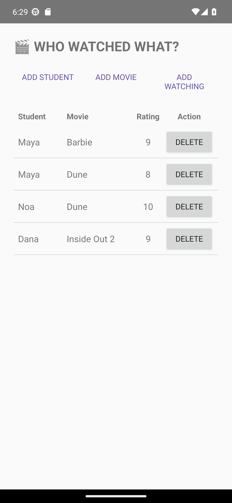

# Class Netflix · Android database teaching sample

**Java · XML · View Binding · SQLite · Requery · RecyclerView**

A small, runnable example by **Guy Siedes (3strategy)** for teaching how Java
entities become SQLite tables, how relationships carry their own data, and how
a typed JOIN becomes a list on an Android screen.

[Four-part Hebrew tutorial](https://xn--5dbqnj.xn--eebf2b.com/android/sqlite/)
· [MIT license](LICENSE)



## What you can learn

- Define Student, Movie, and Watching entities with generated typed attributes.
- Model a many-to-many relationship whose junction table also stores a rating.
- Read the same relationship as SQL and as a typed Requery INNER JOIN.
- Add students, movies, and ratings through simple dialogs.
- Bind joined results to a RecyclerView and delete one relationship using its
  composite key, preserving the student and movie.

This is a focused Requery lesson. Database operations are deliberately direct
and synchronous so their path remains visible; it is not a production threading
or architecture template. The app supports create, read, and relationship
deletion; it does not include editing existing records.

## Build and run

1. Open this repository in Android Studio with support for its checked-in
   Android Gradle Plugin version (see `gradle/libs.versions.toml`).
2. Use Android Studio's bundled JDK; this release was checked with JBR 25.
3. Install **Android SDK Platform 37** and let Gradle sync.
4. Run `app` on Android **12 / API 31 or newer**.

The Java source language level is 11; the JDK used to run Gradle is separate.
Keep the checked-in Gradle wrapper and version catalog.

```powershell
$env:JAVA_HOME = 'C:/Program Files/Android/Android Studio/jbr'
./gradlew.bat :app:assembleDebug :app:lintDebug
```

On macOS/Linux, set `JAVA_HOME` to a compatible JDK and run
`./gradlew :app:assembleDebug :app:lintDebug`.

The debug APK is `app/build/outputs/apk/debug/app-debug.apk`.
No Firebase configuration, account, or network permission is needed. The first
launch seeds fictional students and example movie titles into a local database.

## Follow the lessons

| Lesson | Working result |
| --- | --- |
| 1 · Student entity | A generated entity and a local SQLite table |
| 2 · Rated relationship | Students and movies linked through Watching |
| 3 · JOIN and inserts | Joined rows and three add dialogs |
| 4 · RecyclerView and deletion | A reusable row with targeted relationship deletion |

This repository is the completed reference. If you follow the lessons manually,
build your own incremental project alongside it.

## Understand the code


## 1. The three tables

```text
Student                 Movie                   Watching
-------                 -----                   --------
id                      id                      studentId
name                    title                   movieId
                        genre                   rating

Student 1 -------- * Watching * -------- 1 Movie
```

## 2. Why Watching is an entity

`Watching` is not just an invisible many-to-many link. The relationship has its own data—`rating`—so it is a real Java entity and a real SQLite junction table.

## 3. The SQL INNER JOIN

```sql
SELECT s.name, m.title, w.rating
FROM Student s
INNER JOIN Watching w
    ON w.studentId = s.id
INNER JOIN Movie m
    ON m.id = w.movieId;
```

## 4. The Requery equivalent

This is the exact typed query used in `MainActivity`:

```java
data.select(StudentEntity.NAME, MovieEntity.TITLE, WatchingEntity.RATING,
            WatchingEntity.STUDENT_ID, WatchingEntity.MOVIE_ID)
    .from(Student.class)
    .join(Watching.class).on(WatchingEntity.STUDENT_ID.eq(StudentEntity.ID))
    .join(Movie.class).on(MovieEntity.ID.eq(WatchingEntity.MOVIE_ID))
    .orderBy(StudentEntity.ID, MovieEntity.ID)
    .get();
```

There are no table or column-name strings in this Java query. Requery generated the typed attributes such as `STUDENT_ID` from the entity definitions. SQL logging is enabled, so the generated SQL is visible in Logcat.

The first three selected values are the SQL lesson's visible result. The two extra IDs are
`Watching`'s composite key, carried in the same tuple so a row's Delete button can target the real
association even if two students share a name or two movies share a title:

```java
data.delete(Watching.class)
    .where(WatchingEntity.STUDENT_ID.eq(studentId)
        .and(WatchingEntity.MOVIE_ID.eq(movieId)))
    .get().value();
```

`value()` executes Requery's lazy delete and returns the affected-row count. The Activity then
reruns the join and gives the fresh tuples to the RecyclerView adapter.

## 5. Class-first idea

```text
Java entity definitions
        ↓
Requery annotation processor
        ↓
generated entities + Models.DEFAULT
        ↓
SQLite tables
```

## 6. Where to look

- `model/Student.java`, `Movie.java`, and `Watching.java`: the three tables and relationships.
- `Database.java`: opens SQLite and contains the inserts and typed Watching delete.
- `MainActivity.java`: add dialogs, the typed INNER JOIN, and RecyclerView setup.
- `WatchAdapter.java`: binds each join tuple and forwards Delete clicks.
- `activity_main.xml` and `item_watching.xml`: the screen and its one reusable row.

The three top buttons add a Student, a Movie, or a Watching relationship. “Add Watching” chooses
an existing student and movie and stores the relationship's rating. Each joined row has a Delete
button that removes only that Watching relationship; both operations refresh the list immediately.
The row layout uses separate Student, Movie, Rating, and Action columns with matching headers and
RecyclerView dividers, rather than formatting an entire row into one TextView.

The handwritten Java files contain the tutorial's final explanatory Javadocs. They focus on generated Requery code, SQLite mapping, association keys, inserts, typed queries, and the few deliberate UI tradeoffs.

Build with `gradlew.bat assembleDebug`. Requery 1.6.0 is loaded from Maven Central with
`implementation` plus Java's standard `annotationProcessor` configuration. RecyclerView 1.4.0 is
the only UI library added for the list.

This project and the manual tutorial twin intentionally share `com.example.sqlrequery`, the
`class-netflix.db` file, and schema version 2. Installing either APK replaces the other's code but
keeps that shared app data; using an older schema version afterward would be an unsupported SQLite
downgrade.


## Validation and reuse

See [release validation](docs/VALIDATION.md) for checks and limitations.
Application code and project documentation are available under the [MIT license](LICENSE).
Dependencies retain their own licenses; see [third-party notices](THIRD_PARTY_NOTICES.md).
